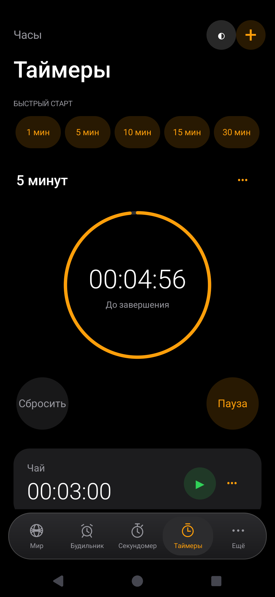
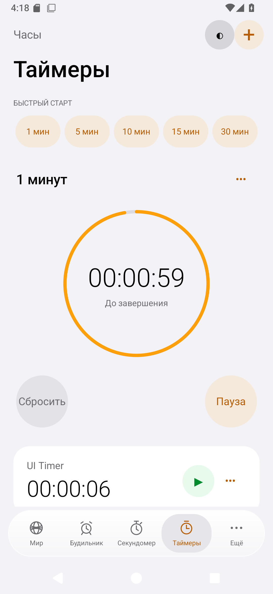

# Проверка в Android Emulator — 21 ноября 2026

Проверка выполнена на работающей Android-системе. Исходная версия — опубликованный APK 1.1.1; найденные ошибки восстановления звука исправлены в 1.1.2. Код интерфейса при этом не менялся. Снимки основных экранов относятся к 1.1.1 и 1.1.2; повторная проверка восстановления и малого экрана выполнена на 1.1.2.

## Среда

| Параметр | Значение |
| --- | --- |
| Android | 15, API 35, официальный AOSP x86_64 образ |
| Эмулятор | Android Emulator 37.4.1, WHPX |
| Основной экран | 1080 × 2340, 420 dpi |
| Уменьшенный экран | 720 × 1280, 320 dpi — ширина 360 dp |
| Данные | Отдельный тестовый AVD, фиктивные названия задач и сигналов |

APK устанавливался через ADB. Действия выполнялись касаниями, прокруткой и клавиатурным вводом. Состояние проверялось в хранилище тестового приложения, службы и звуковые потоки — через Android dumpsys. Для чтения дерева постоянно обновляющихся часов применён отдельный instrumentation-помощник без ожидания остановки анимации; в APK часов он не входит.

## Результаты

| Сценарий | Результат |
| --- | --- |
| Обновление опубликованного 1.0.1 поверх установленной копии до 1.1.1 | Сохранены тема, порядок и объекты таймеров, работающий дедлайн |
| Светлая и тёмная темы | Переключаются; просмотрены реальные снимки, подписи расположены под значками |
| Работающий таймер при переключении темы | Объект и точный дедлайн не изменились |
| Таймер: пауза, сброс, ручной ввод, прокрутка колеса | Работают; нулевая длительность отклоняется, новый таймер сохранён первым |
| Шестисекундный таймер в фоне, экран выключен | Сработал, открыл сигнал, запустил звуковой поток USAGE_ALARM; подтверждение сбросило таймер и остановило звук |
| Секундомер | Старт, круг и остановка работают, результат сохраняется |
| Мировые часы | Отображаются города и время; поиск отфильтровал несовпадающее имя, Дубай добавлен из каталога |
| Настройки | Ползунок меняет и сохраняет громкость, звук включается/выключается; неправильный шаг отклоняется; стрелки шага меняют его на одну секунду |
| Фокусировка | Текст задачи сохранился после ухода в фон и остановки процесса; интервалы работы/перерыва по минуте применены |
| Будильник и завершение фокусировки | Оба сработали в реальном времени в фоне; системные часы не ускорялись |
| Два сигнала и отсрочка | Отсрочка будильника на пять минут оставила звук фокусировки активным; подтверждение последнего сигнала остановило службу |
| Завершение фокусировки | Счётчик сессий увеличился до 1, подготовлен минутный перерыв |
| Повтор будильника | Сохранены все семь дней, следующая дата перенесена на завтра; переключатель отключает и снова включает расписание |
| Перезагрузка Android с просроченным таймером — после исправления | Сохранённый дедлайн восстановлен без открытия часов, запущены служба и звук |
| Длительный сигнал после перезагрузки | Служба, флаг сигнала и звуковой поток оставались активны более 65 секунд, затем остановлены подтверждением |
| Принудительная остановка и повторный запуск — окончательная 1.1.2 | Звук прекращается при остановке процесса и восстанавливается при повторном открытии сохранённого сигнала |
| Малый экран и пересоздание Activity | Таймеры сохранены, все пять пунктов навигации доступны, кнопка сохранения редактора достижима прокруткой |
| Журнал окончательной сборки | После её установки и проверок нет FATAL EXCEPTION в AndroidRuntime |

После перезагрузки эмулятор показал разблокированный домашний экран: восстановленный сигнал был доступен в уведомлениях, окно подтверждения открыто нажатием на уведомление. Автоматический полноэкранный показ после загрузки ОС не заявляется. При обычном выключении экрана перед срабатыванием таймера окно сигнала открылось автоматически.

## Найденные ошибки и исправления

1. В 1.1.1 восстановленный после загрузки сигнал вызывал `ForegroundServiceStartNotAllowedException: FGS type mediaPlayback not allowed to start from BOOT_COMPLETED!`. Даже новый точный PendingIntent получал ещё действовавшую причину разрешения BOOT_COMPLETED. В 1.1.2 на Android 14+ выбран тип `systemExempted`, предусмотренный для приложений точных будильников; на более старых версиях остаётся mediaPlayback/обычный foreground API. Основание: [тип службы сигналов](https://developer.android.com/about/versions/14/changes/fgs-types-required#system-exempted), [ограничение Android 15](https://developer.android.com/about/versions/15/changes/foreground-service-types).
2. При повторном открытии после системной принудительной остановки состояние активного сигнала восстанавливалось визуально, но служба не запускалась. MainActivity теперь восстанавливает её при наличии сохранённых неподтверждённых сигналов. Сценарий воспроизведён до исправления и успешно пройден после него.

## Снимки

 

Другие экраны: [редактор таймера](android-verified-timer-editor.png), [секундомер](android-verified-stopwatch.png), [мировые часы](android-verified-world.png), [настройки](android-verified-settings.png), [фокусировка](android-verified-focus.png), [будильник](android-verified-alarms.png), [редактор будильника](android-verified-alarm-editor.png), [сигнал](android-verified-signal.png), [два сигнала](android-verified-multiple-signals.png), [после перезагрузки](android-verified-reboot-signal.png), [малый экран](android-verified-small-screen.png), [редактор на малом экране](android-verified-small-editor.png).

## Границы проверки

Это AOSP Android 15, не Samsung One UI. Реальный Samsung, Android 8–14/16+, режим «Не беспокоить», агрессивное энергосбережение производителя и перезагрузка с PIN/зашифрованным пользовательским хранилищем не проверены. Эмулятор запущен с отключённым звуком на компьютере: подтверждены декодирование и активный Android-аудиопоток, но не слышимость и качество динамика телефона. FPS, расход батареи и физическое наведение мышью не измерялись.

Тестовые инструменты и исходные журналы находятся локально в игнорируемом `.tools`; пользовательские документы и настройки телефона не использовались. Сигналы в тестовом AVD после проверки подтверждены, будильник отключён.
