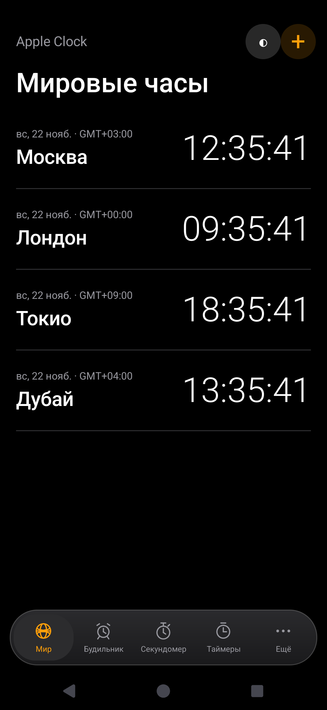
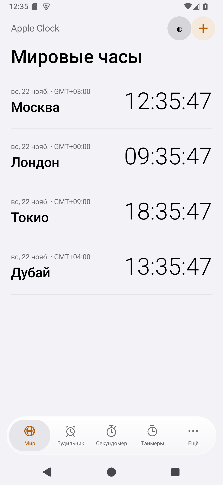
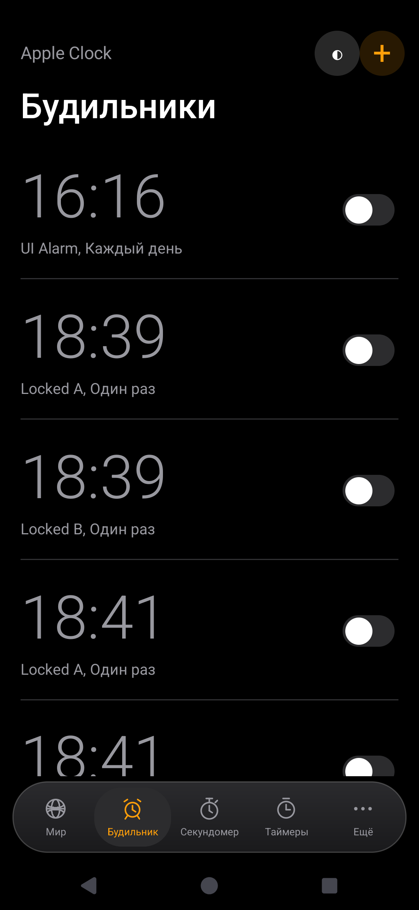
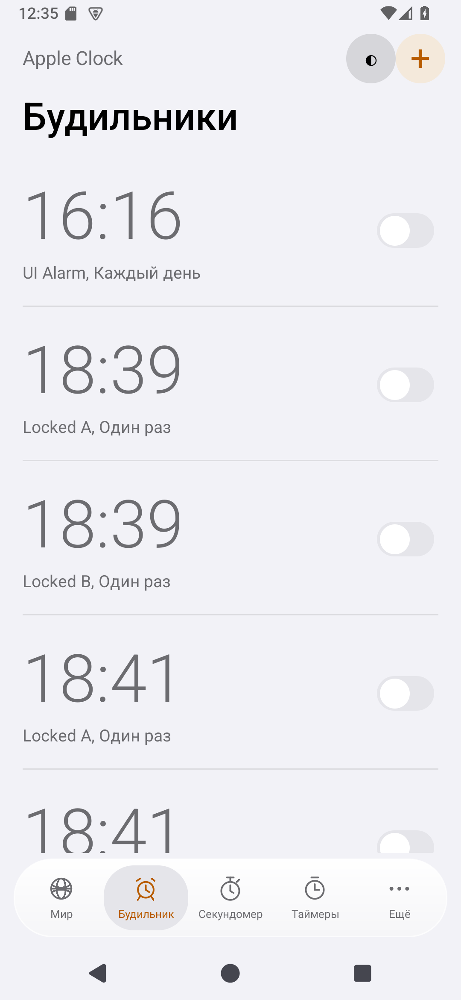

# Проверка интерфейса 1.1.4

22 ноября 2026 года. Подписанный APK (versionCode 7) установлен поверх предыдущей версии в Android Emulator / Android 15, API 35, WHPX.

- На вкладках «Мир», «Будильники», «Секундомер», «Таймеры» в светлой и тёмной темах найдена верхняя надпись Apple Clock. Она не нажимается. Надписи «Править», «Готово» и прежнее «Часы» отсутствуют.
- После обновления сохранены выбранная тема, таймеры, будильники, города, громкость и задача фокусировки.
- Нажатие на время будильника открывает редактор. Долгое нажатие открывает оформленное подтверждение удаления. Проверены отмена и удаление временного будильника.
- Проверены добавление временного города, долгое нажатие на его строку, отмена и удаление. Существовавшие до проверки города сохранены.
- Проверено сохранение темы после повторного открытия. Падений Apple Clock в crash-буфере Android нет.
- Сборка и проверка подписи успешны; сертификат совпадает с опубликованными 1.0.0 и 1.0.1. ZIP и выравнивание APK проверены.

Снимки ниже просмотрены. Проверка выполнена в эмуляторе, физический Samsung не подключался. Сигналы и PIN-блокировка в этом выпуске не менялись; их проверка описана в [отчёте 1.1.3](lockscreen-timers-verification.md).

