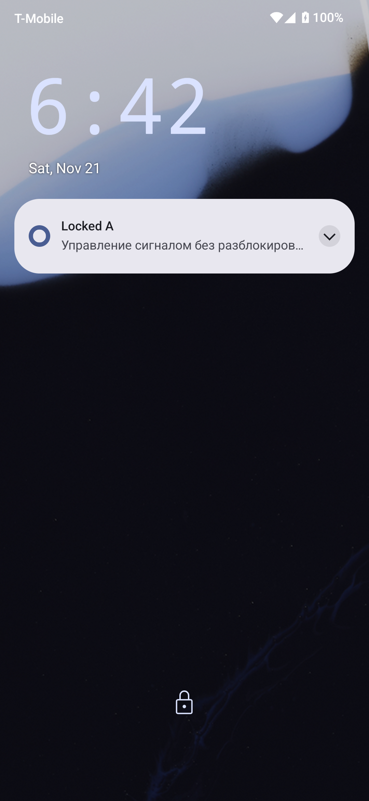
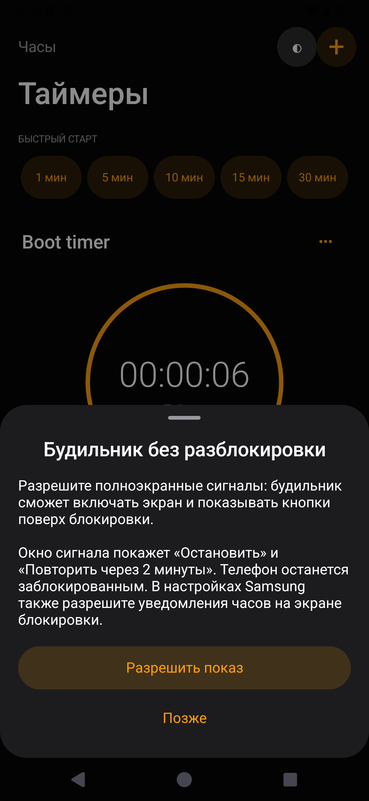
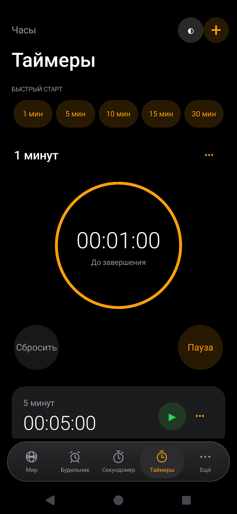

# Проверка Apple Clock 1.1.3

21 ноября 2026 года. Окончательный APK установлен поверх предыдущей версии в Android Emulator 37.4.1 с WHPX, Android 15 / API 35, AOSP x86_64. Размер APK — 377 375 байт; versionCode 6. Подпись совпадает с опубликованными выпусками 1.0.0 и 1.0.1. Проверены целостность ZIP, выравнивание и 37 JVM-проверок логики и планирования.

## Будильник при заблокированном экране

В изолированном эмуляторе временно установлен PIN. Перед срабатыванием Android подтвердил DeviceLocked=true, KeyguardLocked=true, KeyguardSecure=true; экран выключен. После проверки временный PIN удалён.

- При запрещённом полноэкранном доступе два будильника сработали за защищённым экраном блокировки. В развёрнутом уведомлении нажата кнопка «Через 2 минуты»: назначен срок now + 120 000 мс, первый сигнал выключился, второй продолжил звучать. PIN не вводился, телефон остался заблокированным.
- Кнопка «Остановить» в уведомлении выключила оставшийся сигнал и службу воспроизведения без открытия приложения и разблокировки.
- Затем полноэкранный доступ разрешён через ADB только в тестовом эмуляторе. После реального ожидания двух минут отложенный будильник сработал снова. Экран включился, показалось окно с кнопками «Остановить» и «Повторить через 2 минуты». Все три признака защищённой блокировки остались true.
- Нажатие «Остановить» в полноэкранном окне остановило службу и аудиопоток; телефон остался заблокированным.
- При отсутствующем доступе приложение показало оформленную подсказку «Будильник без разблокировки». Кнопка «Разрешить показ» открыла системные настройки. Доступ предоставляется пользователем; приложение не снимает блокировку и не выдаёт разрешения самостоятельно.

## Таймеры

После создания таймеров на пять и одну минуту запуск нижнего пятиминутного перенёс его наверх. После паузы запуск нижнего минутного сделал главным минутный таймер, а пятиминутный переместил ниже. Длительность, остаток и состояние прежнего главного таймера сохранены без изменений.

Последовательность пауза / старт / сброс / старт / пауза / сброс проверена по интерфейсу и сохранённым данным. В светлой теме также проверены старт, пауза и сброс, просмотрен снимок. Теперь меняется список таймеров внутри существующего экрана: заголовок, навигация и ScrollView не создаются заново при каждом нажатии.

Отдельно проверена остановка короткого таймера через уведомление при открытом приложении: служба завершилась, а видимый интерфейс обновился и снова показал «Старт». В crash-буфере Android падений Apple Clock не обнаружено.

Записано восемь секунд работы этих кнопок через Android screenrecord. Анализ FFmpeg области неподвижного заголовка (1080 × 500, y=100) охватил 176 кадров: средняя яркость находилась в диапазоне 26,4373–26,4475, пропаданий или белых вспышек заголовка не обнаружено. Это проверка конкретного сценария в эмуляторе, а не измерение FPS или плавности на Samsung.

## Ограничения

Снимки перечисленных экранов просмотрены. Физический Samsung и его One UI не подключены: настройки видимости уведомлений и полноэкранного доступа нужно проверить на телефоне. Звук хоста эмулятора отключён; запуск и остановка аудиопотока подтверждены средствами Android, слышимость динамика телефона не проверялась. Расход батареи и производительность на реальном устройстве не измерялись. Проверки остальных функций предыдущего выпуска сохранены в [отчёте 1.1.2](android-emulator-verification.md).
