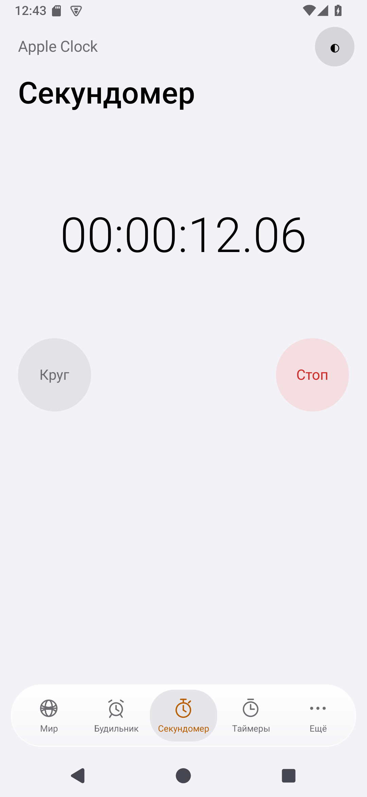
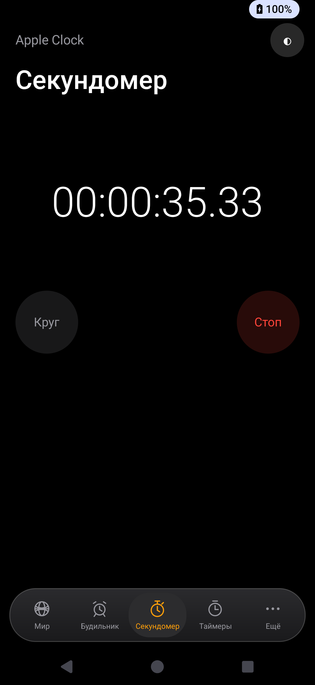
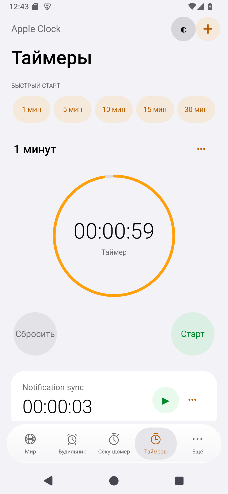
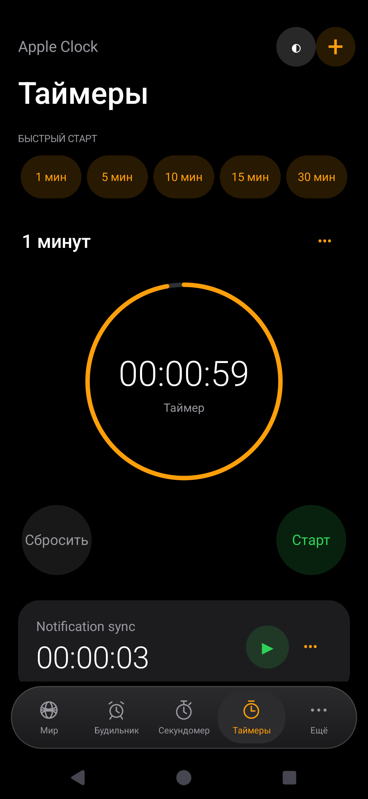

# Адаптивная частота: версия 1.1.5

22 ноября 2026 года. Android Emulator с WHPX, Android 15 / API 35, 1080 × 2340. Эмулятор сообщает частоту около 60 Гц. Физический Samsung не подключён.

## Что изменилось

Каждое окно приложения определяет максимальную частоту среди режимов с тем же физическим разрешением, включая альтернативные частоты на поддерживаемых версиях Android. Разрешение не переключается. Слушатель изменений дисплея обновляет выбор во время работы.

`preferredRefreshRate` передаёт предпочтение окна Android; на API 35 дополнительно используется `View.setRequestedFrameRate`. Касания, инерционная прокрутка и видимые анимации поддерживают запрос. Через 1,2–2,4 секунды без движения он снимается; при потере фокуса или включении энергосбережения — сразу. Во время непрерывной анимации параметры окна не обновляются на каждом кадре. Слушатели дисплея и энергосбережения освобождаются при потере фокуса.

Таймер и секундомер запрашивают следующий кадр через `postInvalidateOnAnimation`, то есть следуют фактическому VSync, а не фиксированной задержке. Видимость, фокус и наличие видимой области проверяются перед продолжением цикла; возврат фокуса возобновляет отрисовку. Таймер с нулевым остатком не продолжает анимацию кольца. Системный ValueAnimator редактора времени сохранён.

Запрос частоты не гарантирует соответствующий FPS. Окончательное решение принимает Android с учётом политики устройства. Основания: [Frame rate API](https://developer.android.com/media/optimize/performance/frame-rate), [адаптивная частота для Views](https://developer.android.com/develop/ui/views/animations/adaptive-refresh-rate).

## Выполненные проверки

- APK установлен поверх 1.1.4. Тема, таймеры, будильники, города, громкость и задача сохранены.
- На неподвижном секундомере предпочтение окна равно 0. После старта — 60,000004 Гц, что соответствует режиму тестового дисплея. Секундомер создаёт кадры по VSync.
- После остановки секундомера предпочтение возвращается к 0. В двухсекундной выборке счётчик `gfxinfo` не увеличился: 0 кадров. В фоне также отсутствует непрерывная отрисовка, но отсчёт времени продолжается. После возвращения анимация и запрос частоты возобновляются.
- В отдельной трёхсекундной выборке работающего секундомера счётчик вырос на 184 кадра. Это проверка работы цикла на виртуальном дисплее, не замер физических FPS Samsung и не гарантия плавности каждого кадра. Эмулятор использует программную графику, его время отрисовки не характеризует производительность телефона.
- Работающий таймер запрашивает частоту дисплея. Пауза возвращает выбор Android. Отдельное окно редактора также получает запрос при взаимодействии.
- При включённом энергосбережении запрос снят; после отключения во время анимации восстановлен. Для этой проверки временно имитировано отключение зарядки эмулятора. Режим батареи и энергосбережение затем восстановлены.
- Касание после простоя снова включает запрос; спустя простой он снимается.
- Смена темы во время работы секундомера сохраняет анимацию. Светлая и тёмная темы просмотрены на снимках ниже. Падений приложения в crash-буфере Android нет.
- 14 JVM-проверок политики частоты: выбор 60/90/120/144 Гц, отказ от смены разрешения и некорректных частот, отсутствие запроса в простое, без фокуса и при энергосбережении. Команда запуска приведена ниже.
- Подпись APK совпадает с опубликованными 1.0.0 и 1.0.1; ZIP и выравнивание проверены.

```powershell
javac -encoding UTF-8 -d build/logic app/src/main/java/com/maksimdenisov/appleclock/RefreshRatePolicy.java tools/RefreshRateTest.java
java -cp build/logic com.maksimdenisov.appleclock.RefreshRateTest
```

На реальном устройстве ещё нужно измерить время кадров при 120 Гц и переключении системной частоты. Тепловые ограничения, батарея телефона, конкретная One UI и режимы внешних дисплеев здесь не проверены. Нет утверждения о постоянных 120 FPS или снижении расхода батареи на измеренный процент.








